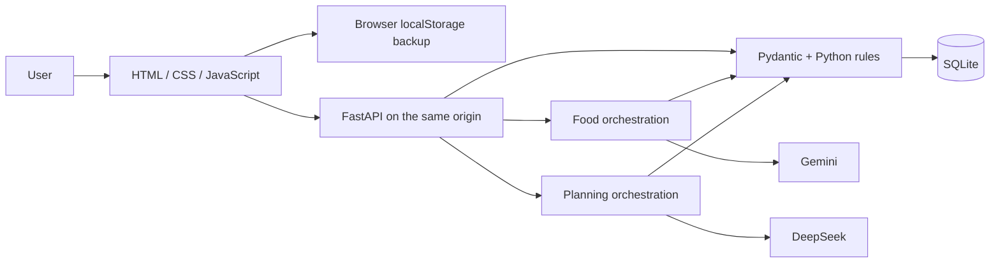
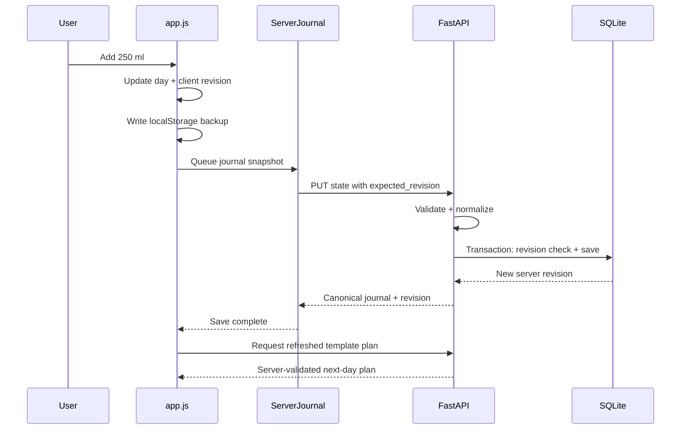
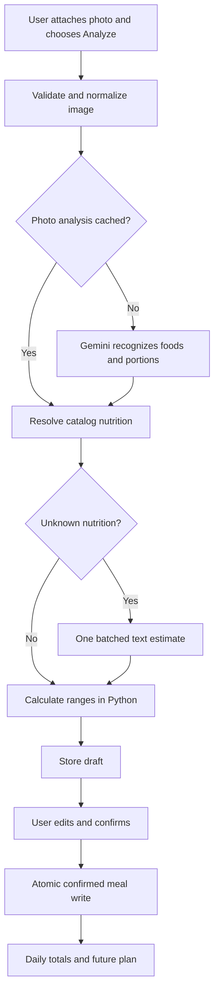
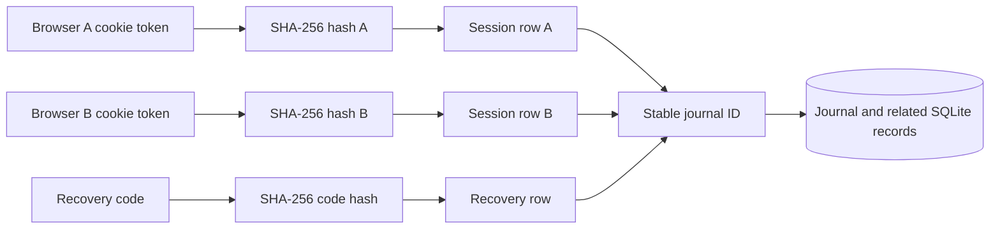
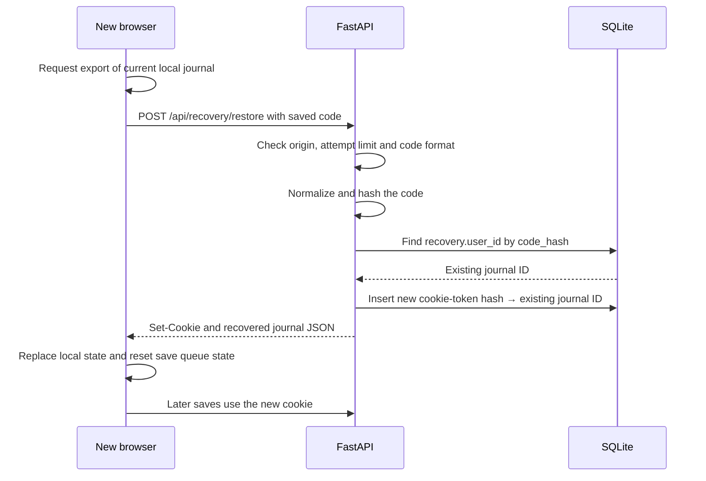

# BurnRate: a developer’s guide to the stack and pipeline

Updated October 14, 2026. This guide explains the code that exists in this repository, the reasons behind it, and patterns you can reuse in other applications. `IMPLEMENTATION.md` is the delivery checklist; `backend/README.md` is the setup and endpoint reference. The two original pipeline specifications describe a broader target than the current MVP.

## Reading map

| If you want to understand… | Read |
|---|---|
| The complete architecture | Sections 1–3 |
| Frontend state and persistence | Sections 4–6 |
| Database writes and concurrency | Sections 7–9 |
| Gemini photo logging | Sections 10–12 |
| DeepSeek planning | Sections 13–14 |
| Failures, security and deployment | Sections 15–18 |
| Testing and reuse in another product | Sections 19–22 |
| Journal identity, recovery codes and backups in detail | Section 23 |

## 1. The stack, with each tool’s job

| Layer | Technology | Its job here | Main file |
|---|---|---|---|
| Page structure | HTML | Document shell, dialog and script loading | `frontend/dist/index.html` |
| Visual design | CSS | Mobile layout, cards, viewport sizing and responsive rules | `frontend/dist/style.css` |
| UI behavior | Vanilla JavaScript ES modules | Navigation, forms, drafts, state and rendering | `frontend/dist/app.js` |
| Local calculations | JavaScript | Immediate browser-mode totals and template plans | `frontend/dist/domain.mjs` |
| API client | Browser Fetch API | Same-origin requests and serialized saves | `frontend/dist/server.js` |
| Server language | Python | Validation, business rules and orchestration | `backend/app/` |
| Web framework | FastAPI | Routes, request models, dependencies and API documentation | `backend/app/main.py` |
| HTTP server | Uvicorn | Runs the ASGI application and accepts HTTP connections | Launch command |
| Data contracts | Pydantic v2 | Parses input, validates fields and checks relationships | `backend/app/models.py` |
| Database | SQLite through `sqlite3` | Journals, revisions, mutations, drafts and caches | `backend/app/storage.py` |
| Outbound networking | HTTPX | Calls Gemini and DeepSeek asynchronously | `backend/app/providers.py` |
| Image processing | Pillow | Decode, orient, resize and strip image metadata | `backend/app/food.py` |
| Secrets/configuration | Environment variables + python-dotenv | Load server-only configuration from `.env` | `backend/app/main.py` |
| Tests | pytest, FastAPI TestClient, HTTPX MockTransport | Exercise real API logic with temporary storage and fake providers | `backend/tests/test_api.py` |

The frontend is buildless: the browser loads the modules directly. There is no bundler, frontend package installation or compilation step. `dist/` currently contains the maintained source assets, despite the directory name usually meaning generated output in framework projects.

FastAPI is the application; Uvicorn is the process serving it. Keeping these roles distinct helps when debugging: a process startup problem differs from an API route failure.

SQLite is a practical starting point for one service instance and a modest journal. An external database becomes useful when multiple server instances need shared durable storage or your query and write workload grows.

## 2. The architecture



The important boundaries are:

1. **UI → API:** browser data must be validated, even if the form already checks it.
2. **API → external model:** requests have deadlines, costs and failure modes.
3. **Model → business logic:** generated JSON is a proposal until it passes validation.
4. **Draft → confirmed record:** inferred food is reviewed before entering totals.
5. **Calculated plan → published plan:** the journal revision must still match.

These boundaries matter more than the specific providers. The same design could use another vision model, another language model, or no AI at all.

## 3. Two operating modes

### Static mode

The public Sites deployment serves static dashboard files. Its `config.js` contains:

```javascript
window.BURNRATE_API = false;
```

The dashboard uses localStorage and JavaScript calculations. It does not contact the local Python service or send stored journals to a backend automatically. The public site currently has no login requirement.

### Python-connected mode

Uvicorn serves FastAPI, and FastAPI also serves the dashboard assets. The backend intercepts `/config.js` and returns:

```javascript
window.BURNRATE_API = true;
```

The UI then initializes a session, loads or creates a server journal, and uses the Python API. The URLs share an origin:

```text
http://127.0.0.1:8000/                dashboard
http://127.0.0.1:8000/config.js       runtime configuration
http://127.0.0.1:8000/api/session     API
```

An origin includes scheme, hostname and port. `localhost:5173` and `127.0.0.1:8000` are different origins. Their browser storage is separate too.

This runtime-config pattern lets you use the same frontend assets in multiple environments. Configuration can expose a feature flag; it must never expose an API key. Changing the flag on the public static site alone would not deploy a Python service.

## 4. How the frontend renders

`app.js` holds a journal object named `state`, a selected date, the active page, and temporary form state. Page functions return HTML strings. `render()` replaces the application content and `bindView()` attaches handlers to the new elements.

The basic cycle is:

```text
User action → update state → persist → render → bind handlers
```

For example, adding water updates `state.days[selected].water`, increments the client revision, saves a local backup and redraws the view.

The food dialog has a different boundary: edits first update `draft`. The confirmed journal does not receive the draft until the user confirms it.

Advantages of the current approach:

- Few dependencies and straightforward local setup.
- A small application can be understood by following ordinary functions.
- Immediate rendering does not wait for an API round trip.

Costs as the application grows:

- Whole-page rendering can disturb focus and scroll position.
- Event handlers must be attached after every replacement.
- Large HTML template strings become hard to review.
- Asynchronous responses can arrive while a user is editing another view.

For a larger version, split page components, form state, storage and API state before adding more features. A component framework can make that separation easier. Changing frameworks does not replace the backend validation or transaction logic.

Dynamic text is escaped with `esc()` before insertion into templates. SQL parameters and HTML escaping solve different problems; you need both at their respective boundaries. Free-text model explanations still need product review, even when they are safely escaped for HTML.

## 5. Follow a water update end to end



The UI is optimistic: it updates immediately. The backup means a failed request does not immediately erase the edit. The server response provides the accepted, normalized values.

Optimistic display is not proof of persistence. If you reuse this pattern, show whether data is pending, saved or paused. BurnRate currently uses a connection label and error toast; a dedicated persistent save-status indicator would improve this.

## 6. The save queue and the two revisions

`ServerJournal` in `server.js` has:

```text
pending       newest snapshot waiting to save
running       the current pump promise
revision      last accepted server revision
blocked       save queue is paused after an error
```

While one request is running, later edits replace `pending` with the newest full snapshot. The pump sends requests sequentially.

Example:

```text
Snapshot A is being sent.
Edit B becomes pending.
Edit C replaces pending B.
A succeeds; C is sent next.
```

This is safe for complete snapshots because C includes B's final state. It would be unsafe for a command queue: replacing “add item B” with “add item C” would lose a command.

There are two distinct revision numbers:

| Revision | Owner | Purpose |
|---|---|---|
| `state.revision` | Frontend journal | Invalidates locally derived plans when content changes |
| Response `revision` / `expected_revision` | SQLite storage | Prevents one client from overwriting a newer server snapshot |

A plan response also includes `server_revision`, allowing the UI to identify a server-validated result for the current saved state.

On a conflict or network failure, the queue pauses and retains a pending snapshot. Automated reconnect and offline merging are not implemented. Reloading can load the server's older accepted data, so export unsaved local edits before reloading after a failure. For production, replace this manual recovery with an explicit reconcile flow.

## 7. Validation belongs at multiple levels

In `models.py`, the shared model configuration rejects unknown fields and non-finite floating-point values. Numeric bounds constrain portions, weight and activity metrics.

Pydantic then checks relationships:

- Every activity session references an existing activity.
- Distance activities include a distance.
- Repetition activities include reps or a hold duration.
- Record IDs and meal-item IDs are unique within their collections.
- A weight date appears once.
- Actual logs are not future-dated in the configured application timezone.
- Eating-window settings contain the meal times.
- Calorie bounds satisfy `low <= kcal <= high`.

An example of a cross-field rule:

```python
# Simplified learning example, not a replacement for the project models.
from pydantic import BaseModel, ConfigDict, Field, model_validator

class Range(BaseModel):
    model_config = ConfigDict(extra="forbid", allow_inf_nan=False)
    low: float = Field(ge=0)
    high: float = Field(ge=0)

    @model_validator(mode="after")
    def ordered(self):
        if self.low > self.high:
            raise ValueError("Range is reversed")
        return self
```

The framework can validate the type of each field; a model validator expresses the relationship between fields. See [Pydantic's validator documentation](https://docs.pydantic.dev/latest/concepts/validators/).

The current models are not globally configured with `strict=True`: Pydantic can coerce some compatible inputs. “Validation is strict” here means explicit field and relationship checks, not that every type coercion is disabled.

Separate shape validation from business validation. `PlanChoice` can establish that an activity ID is a string; the planner establishes whether that activity is currently eligible.

## 8. How SQLite storage is organized

| Table | Stored data |
|---|---|
| `sessions` | Browser token hashes mapped to stable journal IDs |
| `recovery` | One recovery-code hash per journal |
| `journal` | Current full journal JSON and server revision |
| `journal_revision` | Historical accepted journal snapshots |
| `mutation` | IDs of successful writes |
| `plan_revision` | Validated plans keyed by input hash |
| `draft` | Photo analysis and confirmation status |
| `cache` | User-scoped photo, nutrition and review results |

Activity sessions are inside journal JSON. The SQL table named `sessions` stores browser sessions, not exercise sessions.

This is a **snapshot storage model**. It is not a normalized database with one SQL row per food item, and it is not full event sourcing. Historical snapshots allow inspection of prior accepted state, but the app does not replay domain events to reconstruct that state.

Snapshots reduce the initial integration work because the client and server can share one journal contract. They become expensive when journals grow: every save serializes a full state and adds another full revision. Cross-user reporting and per-item querying also become awkward.

A later normalized model could have `users`, `meals`, `meal_items`, `activities`, `activity_sessions`, `daily_logs` and `settings_revisions`. Preserve the current confirmation and concurrency guarantees while migrating the representation.

## 9. Transactions, conflicts and duplicate requests

`Store.save()` starts a transaction with `BEGIN IMMEDIATE`. Inside it, the store checks the mutation ID, reads the current revision, checks the expected revision, and writes the current journal, history and mutation record.

A conflict example:

```text
Tab A loads server revision 10.
Tab B loads server revision 10.
Tab A saves with expected_revision 10 → accepted as revision 11.
Tab B saves with expected_revision 10 → HTTP 409.
```

Without the check inside the transaction, both clients could pass a stale pre-check and the later writer could overwrite the earlier one.

The mutation ID provides server-side idempotency:

```json
{
  "expected_revision": 10,
  "mutation_id": "synthetic-unique-operation-id",
  "state": { "...": "complete journal omitted" }
}
```

That JSON illustrates the envelope; the omitted `state` is not a valid API payload.

If the same successful mutation ID is submitted again for the same browser journal, the store does not apply it twice. It returns the current accepted journal, which may include later writes; it does not retain and replay the exact original response body.

The frontend generates a new ID for each dispatched save. It does not yet automatically retry ambiguous network failures with the same ID. If you add retries, retain the operation ID and payload until you know whether that operation committed.

SQL uses parameter placeholders for values. IDs and data are not interpolated into query strings.

WAL mode allows readers and a writer to overlap, but SQLite still permits only one writer at a time. It does not turn SQLite into a distributed database. See [SQLite's WAL documentation](https://www.sqlite.org/wal.html).

## 10. The Gemini food pipeline



`prepare_image()` accepts JPEG, PNG and WebP. It limits decoded bytes and pixel count, applies EXIF orientation, converts to RGB, resizes to a maximum 1024-pixel dimension and writes a new JPEG.

Re-encoding keeps the pixels needed for analysis while stripping original metadata. The backend hashes this normalized image and does not persist the raw image. Hashes and structured results still deserve a retention policy; “no raw photo stored” does not mean “no derived data stored.”

Recognition returns food names, preparation, confidence, hidden-ingredient notes and a portion method. The implemented methods are:

| Method | Example | Required basis |
|---|---|---|
| `units` | One medium egg | Defined unit |
| `estimated_mass` | 90–140 g cooked edible chicken | Grams of edible cooked food |
| `volume` | 200–300 ml drink | Milliliters |
| `unknown` | Obscured serving | User clarification |

The MVP does not implement calibrated plate area or bowl-density conversion. It never assumes 1 ml equals 1 g.

Known catalog matches calculate nutrition locally. Unrecognized nutrition goes into one text request for the unresolved items, reducing calls compared with one request per item.

## 11. Nutrition basis, uncertainty and provenance

A nutrition value needs a denominator:

```text
130 kcal per 100 g cooked rice
75 kcal per one medium egg
```

The calculation is:

```python
kcal = kcal_per_basis * portion_amount / basis_quantity
```

Example with the app's illustrative rice value:

```text
180 g × 130 kcal / 100 g = 234 kcal
```

If the portion is estimated at 150–200 g, store that uncertainty. In the current known-food photo branch, the lower and upper calorie bounds also apply a rough 10% catalog margin. These are approximate application bounds, not scientifically calibrated confidence intervals.

For unknown foods, Gemini estimates a nutrition range per 100 g, 100 ml or one defined unit. Python then scales it using the portion bounds. The response must cover exactly the requested item IDs and preserve the requested quantity and unit.

`food.py` currently emits photo-derived entries with `food: null`, even when it used a catalog match, and records `nutrition_source: catalog_photo`. This prevents the general journal normalizer from replacing the photo's wider range with a manual catalog serving calculation on the next save. A richer schema should separate food identity, nutrition version, portion source and override status instead of using this workaround.

Manual catalog entries use a food ID and are recalculated by `normalize_state()`. Consequently, changing catalog values can alter those entries on later saves. Versioned nutrition snapshots would preserve historical meaning better.

Confirmation and accuracy are different fields of meaning:

```text
Confirmed = the user accepted this entry.
Estimated = the entry still contains uncertain quantities or nutrition.
```

A confidence label from an LLM is not a measured error rate. Validate practical accuracy against weighed portions and known labels.

## 12. Why the draft boundary is important

Before confirmation, `/api/food/analyze` writes to `draft`. Daily totals read confirmed `journal.meals`, so merely analyzing a photo does not change intake totals.

On confirmation, the server validates the submitted meal and normalizes catalog values. `confirm_draft()` then performs one transaction that:

1. Checks ownership through the browser session's user key.
2. Checks whether the operation has already succeeded.
3. Checks draft status and the server revision.
4. Adds the meal, updates revisions and records the mutation.
5. Marks the draft confirmed.

A second operation rejects a draft whose current status is already confirmed. A retry with the original successful mutation ID does not add a duplicate. The analysis store currently upserts by the caller-provided draft ID; the frontend creates a fresh UUID each time. Before exposing this API broadly, make confirmed draft records immutable and reject ID reuse during analysis so a caller cannot reset that lifecycle through another analysis request.

The review UI currently allows manual corrections and explicit omission of items. It does not yet implement a rich per-item resolution checklist or retain every intermediate edit as a separate draft revision.

Reuse this boundary in receipt scanning, OCR form extraction or document import: machine extraction creates a draft, and a reviewed confirmation commits business data.

## 13. DeepSeek planning: candidates before generation

Python first computes eligible activity choices and meal-template nutrition. DeepSeek receives a daily brief containing confirmed summaries, recovery data, settings, templates and portion bounds.

The model's output is deliberately small:

```json
{
  "activity_id": "jog",
  "portion_multiplier": 1.0,
  "reason": "Repeat a familiar session within the available time."
}
```

It selects a candidate, a permitted portion multiplier and an explanation. It does not supply authoritative calorie totals or arbitrary new exercises.

The planner validates the choice by running `plan(data, day, choice)`:

- The selected activity must be in the eligible list.
- The multiplier must meet the computed minimum and remain at most 2.
- Python calculates each meal's calories and protein.
- The calculated total must reach the configured intake floor.
- An impossible floor returns a needs-attention result.

The current multiplier applies uniformly to all three fixed meal templates. Individual meal selection, rich food preferences, stage goals and automatic training progression are future work.

Activity preference and effort are separate. The planner favors preferred eligible activities, while logged effort and recovery can remove training options. A partner activity is eligible only when availability is confirmed. A custom activity follows the same general maintain-only logic.

These rules are an MVP policy, not a personalized medical model. Model explanations are free text and are not guaranteed to establish the cause of observed weight changes.

## 14. A stale model response must not become today's plan

An external model can take seconds to respond. During that time, another tab may log a meal, change availability or report pain.

The backend checks `expected_revision` before generation, then `commit_plan()` checks it again inside a transaction before saving the result.

```text
Generate using revision 20.
User reports pain → revision 21.
Model returns a jogging plan based on revision 20.
Commit detects revision mismatch → HTTP 409; plan is not published.
```

The same principle applies to recommendations based on inventory, available appointments or account balances: compute from a versioned snapshot and re-check that snapshot before committing an action.

The weekly review also re-checks the journal after generation. Its review-cache write is not transactionally coupled to that check; strengthen that boundary if a review later becomes a committed decision. Goal dates currently remain unchanged unless the user edits settings.

## 15. JSON mode, validation and the compatibility fix

Both adapters request JSON output. They put the output schema into the instruction and validate the returned content using `schema.model_validate_json()`.

Gemini's nested API-native schema was rejected by the configured model during live testing. The working adapter uses `responseMimeType: application/json` and keeps schema enforcement in Python. DeepSeek uses `response_format: {type: json_object}` and explicitly disables thinking for bounded daily responses.

Valid JSON alone is insufficient:

```json
{"portion_multiplier": -5, "activity_id": "unavailable", "reason": "Example"}
```

That is syntactically valid but fails the application contract. It must not become a plan.

There are three checks after a model response:

```text
Parse JSON → validate the schema → validate current business constraints
```

Do not weaken the application validator merely because a provider rejects a schema keyword. Adapt the provider request format while preserving the application's contract.

For the provider formats, see [Gemini structured-output documentation](https://ai.google.dev/gemini-api/docs/structured-output) and [DeepSeek JSON output](https://api-docs.deepseek.com/guides/json_mode/). Model availability and provider behavior should be re-verified when upgrading.

## 16. Failures, retries and caches

The provider adapter has a maximum of two attempts per stage. Temporary network/status failures and invalid outputs may get a second attempt. Billing and permanent request/configuration errors stop immediately.

| Failure | Current behavior |
|---|---|
| No model or key | Manual logging or rules planning remains available |
| HTTP 402 | Report billing issue; do not repeat the request |
| HTTP 429 or selected 5xx responses | Bounded retry, then unavailable result |
| Invalid JSON/schema | One repair attempt |
| Invalid plan choice | One repair attempt, then rules fallback |
| Recognition unavailable | Keep manual entry available |
| Unknown-food nutrition unavailable | Leave affected items unresolved |
| Save conflict | Pause the server queue; preserve local backup |
| AI quota exceeded | HTTP 429; frontend can show a local template preview |

The repair request includes a short error instruction. It does not currently include the entire previous assistant response. Retry backoff is a fixed short delay; exponential backoff, jitter and provider `Retry-After` handling would improve production behavior.

A photo can involve two stages: recognition and unknown-food nutrition. Two attempts per stage can therefore mean up to four provider requests for that photo. The in-process quota counts endpoint-level AI actions, not every token or every internal provider attempt.

### Cache keys are part of correctness

| Cache | Key inputs |
|---|---|
| Photo recognition | User, normalized image hash, model and `photo-v1` |
| Unknown nutrition | User, food/preparation/basis input hash, model and `nutrition-v1` |
| Daily plan | User, journal content, server revision, date, schema version, AI flag and model |
| Weekly review | User, server revision, date and AI flag; currently stored but not read for reuse |

The same photo can produce a cached analysis and a new draft. It must not silently become a second confirmed meal.

No cache TTL is implemented. The photo key also lacks an explicit catalog version. If you change the catalog or prompt, bump the relevant version or implement proper invalidation. If you want cost savings across a no-op server save, a plan cache based on semantic input rather than server revision would need a careful freshness check.

## 17. Async networking and resource ownership

Provider requests use `httpx.AsyncClient` and `await`. That lets the event loop handle other work while waiting for network responses. It does not automatically make CPU-heavy image decoding or ordinary SQLite calls asynchronous. [FastAPI's async guide](https://fastapi.tiangolo.com/async/) explains the distinction between async routes and synchronous work.

The adapter closes clients it creates. Tests can inject a client and retain ownership of it. That small ownership rule prevents the adapter from unexpectedly closing a shared test or application client.

For a larger service, create a shared HTTP client during application lifespan and close it at shutdown to reuse connection pools. See [HTTPX async usage](https://www.python-httpx.org/async/).

Several async routes currently execute synchronous SQLite operations and Pillow work inline. Under load, move blocking work to a thread pool or use an appropriate async database interface. Also make SQLite connection closure explicit: a sqlite connection's `with` block manages transactions, but is not itself a guarantee that the connection is closed immediately.

These are resource-management improvements to make before treating the prototype as a high-concurrency public service.

## 18. Sessions, secrets and deployment

### Anonymous identity

`GET /api/session` creates a random 32-byte token, gives it to the browser as an HttpOnly cookie, and stores a SHA-256 hash. The hash identifies a session row; its `journal_id` selects the journal. An original session uses its token hash as the journal ID, while a recovered session points a new token hash to that existing ID. The browser does not choose a `user_id` in write requests.

The cookie represents access to one journal. A saved recovery code can now connect another browser session to that same journal without a login screen. Clearing cookies creates a new session until the user recovers the old journal. There is no email recovery or automatic live synchronization. Section 23 explains the complete implementation.

The default local cookie is not Secure because development uses HTTP. HTTPS deployment should enable the Secure flag and configure the exact origin. HttpOnly prevents ordinary JavaScript from reading the cookie; it does not make the application immune to XSS or CSRF.

### Secrets

`backend/.env` contains server configuration. It is excluded from Git, loaded at startup and overridden by already-set process environment variables. The frontend receives capability booleans, not API keys.

Those booleans mean keys and model names are present; they do not verify billing, remaining quota or network connectivity. The Gemini billing issue illustrated this distinction.

The provider log records the provider name, attempt and exception class. Avoid logging request bodies, tokens, photos or full journal snapshots.

### Hosting

The current public URL hosts static assets. The Python backend has been tested locally, but is not deployed behind that URL.

A connected deployment can look like:

```text
Browser → HTTPS reverse proxy → Uvicorn/FastAPI
                              → persistent database volume
FastAPI → provider APIs
```

The proxy can serve frontend files and route `/api/` to Python under one origin. Configure trusted forwarded headers correctly so origin checks and HTTPS behavior match the public origin.

Automatic SQLite snapshots and recovery-code pairing are now implemented. Before public use, add off-server backup scheduling, an appropriate access perimeter, distributed rate limits, operational monitoring, cache/record retention and more complete recovery tooling. The existing per-session quota is stored in one process; a restart resets it, multiple workers do not share it, and an anonymous visitor can acquire another session.

## 19. Tests: check properties that matter

The current Python suite has 34 tests, including the journal recovery and snapshot checks in `backend/tests/test_recovery.py`. The JavaScript domain checker covers the existing local planning behavior. Live synthetic provider checks establish connectivity and response-format compatibility; they do not establish meal-estimation accuracy.

Useful tested properties include:

- One browser cannot read another browser's journal or draft.
- A duplicate operation does not duplicate a committed write.
- A stale revision returns a conflict.
- Server catalog calculations replace incorrect client totals.
- Missing intake and wholly unknown protein remain unknown in API summaries.
- Unavailable partner activities cannot be selected.
- Recovery signals remove training options.
- A stale AI response is rejected before plan publication.
- A draft does not count as confirmed food.
- A permanent billing error gets one attempt.
- Invalid Gemini JSON fields are rejected and repaired within the attempt budget.
- Existing cookie-to-journal mappings survive migration of the old schema.
- Recovered devices share the same journal, and replacement codes invalidate previous codes.
- Recovery works after a service restart and preserves the former journal.
- Backups include committed WAL data, session mappings and recovery hashes.
- Snapshot retention, permissions and visible backup failures behave as intended.

`create_app(db_path, providers)` makes these tests practical: use a temporary database and inject a fake provider. `httpx.MockTransport` supplies deterministic external responses while the real adapter and validators run.

A production test plan should also cover frontend queue races, network failure after commit, two-tab UI recovery, concurrent backend startup races, shared quota behavior and broader migration compatibility. Add tests when these behaviors are implemented; don't claim the current suite proves them.

Run from the project root:

```sh
backend/.venv/bin/python -m pytest backend/tests -q
node frontend/check.mjs
node --check frontend/dist/app.js
node --check frontend/dist/server.js
```

## 20. Reuse the architecture in other products

| BurnRate pattern | Receipt app | Inventory tool | Scheduling app |
|---|---|---|---|
| Perception model | Extract merchant and line items | Read package labels | Extract appointment requests |
| Canonical data | Expense categories and currencies | Product catalog and unit definitions | Services, staff and slot durations |
| Python calculation | Totals, tax and currency conversion | Quantity and reorder calculations | Availability and duration calculations |
| Draft confirmation | User approves expense | User approves stock adjustment | User approves booking details |
| Candidate-based AI choice | Suggest a category | Suggest eligible reorder options | Suggest eligible time slots |
| Revision check | Prevent stale expense edits | Prevent overselling from stale stock | Prevent committing an occupied slot |
| Idempotency ID | Avoid duplicate imported expenses | Avoid duplicate adjustments | Avoid duplicate bookings |
| Fallback | Manual expense form | Manual stock entry | Regular availability search |

The reusable sequence is:

```text
Capture → validate → resolve canonical data → calculate
→ review → commit atomically → derive summaries
→ optionally propose next actions → validate before publication
```

Choose where AI helps with ambiguous perception or selection. Keep identities, quantities, permissions, arithmetic and persistence in ordinary application code.

## 21. Learning exercises

Do these in a separate branch with synthetic data and fake providers first.

### Exercise A: trace one request

Run the Python service, open its dashboard, and add water. In browser DevTools, inspect the `PUT /api/state` envelope, the accepted server revision and the subsequent plan request. Identify where the cookie is attached without JavaScript reading its value.

Expected insight: an immediate UI update, a local backup and an accepted server write are three separate events.

### Exercise B: reproduce a two-tab conflict

Use two clients sharing the same cookie, load the same revision and submit different mutations. Confirm the second stale write returns 409. Then design a UI that offers “reload server state” and “export local edits” without silently discarding either state.

Expected insight: concurrency requires a policy for humans as well as a database check.

### Exercise C: add a catalog food

Add a food with an explicit preparation and basis. The catalog currently exists in Python and JavaScript, so update both or first build a generated/shared catalog contract. Test incompatible units and server recalculation.

Expected insight: duplicated domain data can drift. Server authority helps, but a versioned shared contract reduces that drift.

### Exercise D: add a provider

Implement another provider using the same `generate(provider, prompt, schema, ...)` boundary. Feed fake malformed JSON, a permanent billing error and a timeout. Confirm the domain planner does not need to change.

Expected insight: a provider adapter isolates protocol details, while a typed contract isolates application behavior.

### Exercise E: replace snapshot writes with entity writes

Introduce a `meal` table and an `add_meal` operation. Preserve mutation replay and revision checks. Decide whether versions belong to the whole journal or individual entities.

Expected insight: changing storage shape must preserve the user-visible correctness guarantees.

### Exercise F: add a scheduled plan job

Build the job around a date, user identity and input revision. Ensure running it twice does not publish duplicate plans. Re-check the input revision after the provider responds. Use the user's timezone rather than the machine's local date.

Expected insight: scheduling adds another writer; it does not remove the need for idempotency and freshness.

### Exercise G: evaluate the food pipeline

Create a small, consented dataset of weighed meals. Measure food identity, portion error, calorie error, uncertainty-range coverage and correction rate separately. Compare against a preset/manual baseline.

Expected insight: valid JSON and a passing connection test do not measure product accuracy.

## 22. A practical code-reading order

1. `frontend/dist/index.html`: see what boots the app.
2. `frontend/dist/config.js` and `/config.js` in `main.py`: see how runtime mode is selected.
3. `ServerJournal.initialize()` and `app.js` startup: follow state hydration.
4. `models.py`: learn the contracts before reading route behavior.
5. `PUT /api/state`, `normalize_state()` and `Store.save()`: follow one write.
6. `food.py` and provider response models: follow draft creation and nutrition resolution.
7. `confirm_draft()`: inspect the commit boundary.
8. `planner.py`, `/api/plans` and `commit_plan()`: follow candidate selection and stale-result rejection.
9. `providers.py`: inspect provider-specific JSON envelopes and error handling.
10. Recovery routes, `Store.known_session()`, `Store.set_recovery()` and `Store.recover_session()`: follow identity mapping.
11. `backups.py` and the FastAPI lifespan: follow snapshot scheduling and failure reporting.
12. `tests/test_api.py` and `tests/test_recovery.py`: see which guarantees are actually verified.

Keep `IMPLEMENTATION.md` beside this guide while reading. It distinguishes working behavior from the next iteration so you can reuse the underlying patterns without assuming every production concern has already been solved.

## 23. Journal identity, recovery codes and backups in detail

### 23.1 What a journal means in this app

A journal is the complete set of one person's settings, meal logs, exercise logs, weights, recovery check-ins and saved meals. Most of these records live inside one JSON document in `journal.json`. Its SQL row also contains a stable `user_id`, an authoritative server revision and an update timestamp.

The name `user_id` does not imply a registered account. Here it means the owner key used to scope storage. The first browser session supplies that key indirectly; later recovered sessions can share it.

There are three separate identities to keep straight:

| Identity | Example purpose | Created by |
|---|---|---|
| Journal ID | Selects the complete journal and related server records | Initial server session |
| Browser session token | Lets one browser access that journal | Python `secrets.token_hex(32)` |
| Entry or mutation UUID | Identifies an individual meal, exercise entry or write operation | JavaScript `createId()` |

Changing an entry UUID does not sign you into a journal. Recovering a journal does not create new IDs for its meals. These IDs solve different problems.

### 23.2 Separate the browser credential from the durable journal

Originally, BurnRate used the cookie token's hash directly as the journal ID. That worked for one browser, but a new browser received a different token and therefore a different journal.

The implementation now adds an indirection:



The important relationship is **many browser sessions can point to one journal**. Each browser still has its own secret cookie token. Recovery adds a relationship instead of copying the journal or sharing the original cookie.

The relevant columns are:

```text
sessions
  token_hash   PRIMARY KEY
  journal_id   target journal ID
  created_at

journal
  user_id      PRIMARY KEY; same value as sessions.journal_id
  revision     accepted server write number
  json         complete validated journal state
  updated_at

recovery
  user_id      PRIMARY KEY; one current code per journal
  code_hash    UNIQUE; hash of the canonical recovery code
  created_at
```

The relationship is enforced by application logic; this migration does not add SQL foreign-key constraints between these columns. `Store.set_recovery()` explicitly requires a saved journal before issuing a code.

### 23.3 First visit and subsequent visits

On a first visit, `ServerJournal.initialize(local)` checks `/api/health` and calls `/api/session`. If the cookie is missing or unknown, the backend creates a 32-byte random token, hashes it and inserts a session row. For this original session, `journal_id` equals `token_hash`.

The original token goes into the `burnrate_session` cookie. Only its hash goes into the session table. The API returns journal state and capability flags, not the token in JSON.

If no journal is saved for this ID, the frontend uploads its current local state. This can be sample data or an existing local journal. If a server journal already exists, it takes priority during startup hydration.

On subsequent requests, the browser sends its cookie automatically. The `user` dependency in `main.py` calls `Store.known_session(token)`, which returns the row's `journal_id`. Routes use this value to select journals, drafts, caches and plans. The request body cannot choose another journal's owner ID.

Cookie lifetime is one year from creation. It is not refreshed on every visit. A normal phone restart preserves it when the browser retains site data; expiration, clearing cookies or using another browser can remove access through that token.

### 23.4 Generating the recovery code

In Settings, **Recovery & backups** calls `GET /api/protection` to show whether a code exists and whether snapshots are succeeding.

Creating a code follows this sequence:

1. `protectionSheet()` waits for pending server writes with `backend.flush()`.
2. It sends `POST /api/recovery/code` with the browser's existing session cookie.
3. FastAPI resolves the current journal using the `user` dependency.
4. Python generates `secrets.token_hex(16).upper()`: 16 random bytes, or 128 bits of entropy, represented by 32 hexadecimal characters.
5. `Store.set_recovery()` starts a write transaction and confirms that this journal exists.
6. It stores `SHA256(canonical_code)` in the `recovery` table, replacing any previous code hash for this journal.
7. The response formats the code as `BR-` followed by four groups of eight characters.
8. The UI displays it and offers a text-file download.

The prefix and hyphens make the code recognizable and easier to handle. They do not add randomness. The server hashes the uppercase hexadecimal body, without the prefix or separators.

The code is a high-entropy bearer credential: possessing it grants access to the journal. Hashing is suitable here because the server generates a random secret; this is different from a short human-chosen password that requires a deliberately slow password hash.

The plaintext code is not stored in SQLite or local storage. It remains in the current dialog's memory and any file the user downloads. The server cannot display the existing code later because it only has a hash. Losing it requires creating a replacement from a browser that still has access.

### 23.5 Recovering or pairing another browser

The same recovery flow works for a new phone, a different browser, or a VPN IP with a separate cookie. The user can upload the downloaded recovery `.txt` file instead of copying the code. `parseRecoveryFile()` in `frontend/dist/recovery.mjs` reads the text locally, extracts and normalizes one standalone code, and rejects files larger than 16 KB or containing different codes. The file content is not uploaded; the existing POST still sends only `{code}` after the user presses Recover journal. Manual entry remains available:



`RecoveryRequest` bounds the input length. The route uppercases it, strips outer whitespace, removes ASCII spaces and hyphens, and removes an optional `BR` prefix. It requires exactly 32 hexadecimal characters afterward.

`Store.recover_session()` performs the code lookup and new session insertion in a transaction. An unknown or malformed code returns HTTP 400. A successful lookup creates a fresh 32-byte cookie token; it does not send the recovery code back as the session token.

The new cookie has the same HttpOnly, SameSite, path, expiry and configured Secure behavior as ordinary sessions. Recovery therefore continues to work with the existing API authorization dependency.

The UI waits for active writes, requests an export of the current state, and switches only after the recovery API succeeds. It resets the API client's revision, pending snapshot and blocked flag, installs the recovered state, clears temporary food drafts and refreshes the plan. The local persistence call runs with `hydrating=true` so it does not immediately upload an old journal to the recovered session.

A download request is not proof that the browser saved the file. Users should check the exported file if their current journal matters.

### 23.6 What recovery changes, and what it preserves

Recovery changes this browser's cookie and the journal currently displayed in it. The former server journal is not deleted. The new browser's old session row also remains in the database.

Existing devices keep access to the recovered journal. All linked devices use the same server revision counter and the same journal-scoped caches and plan records.

This enables access across devices but does not add live synchronization. Device B can save a change while Device A still displays an older snapshot. Device A's stale save receives HTTP 409; its frontend pauses and retains local edits. Export those edits before reloading. Automatic conflict merging is not implemented.

Export/import and recovery have different meanings:

| Operation | Meaning |
|---|---|
| Export JSON | Produce a portable copy of the current journal state |
| Import JSON | Replace the current session's journal with that copy |
| Recover with code | Link this browser to the existing server journal |
| Restore SQLite snapshot | Roll back server journals and identity mappings to a saved point |

Two different IP addresses remain different browser cookie hosts. Entering the same recovery code at each address connects their separate cookies to the same server journal. Simply changing networks while keeping the same address normally reuses the existing cookie.

### 23.7 Code replacement and security boundaries

A journal has one active recovery-code hash. Replacing it invalidates the old code for future recovery attempts. It does not revoke cookie sessions already linked to the journal. There is currently no device list, individual device revocation, email reset, code expiry or recovery-code history.

The recovery endpoint permits ten attempts per observed client IP per fifteen minutes. Attempts include successful and failed submissions. The counters live in process memory, reset on restart and are not shared by multiple workers. Reverse-proxy configuration affects which IP the app observes. This is a small-service protection, not a distributed abuse-control system.

Origin checks and the cross-site request check apply to recovery endpoints too. HTTPS protects the token and code in transit; HttpOnly prevents page JavaScript from reading the cookie. HttpOnly does not stop injected JavaScript from making requests using the browser's cookie.

Do not log recovery request bodies or put the code into URLs. Database snapshots contain journal data and browser token hashes, so restrict access to them even though plaintext credentials are absent.

### 23.8 Preserving journals during schema migration

`Store.__init__()` examines `PRAGMA table_info(sessions)`. If `journal_id` is absent, it adds the column. It fills missing values with the existing `token_hash`.

Conceptually:

```sql
ALTER TABLE sessions ADD COLUMN journal_id TEXT;
UPDATE sessions SET journal_id = token_hash WHERE journal_id IS NULL;
```

The column addition is conditional; the update can safely run again. Existing journal IDs do not change, and old cookies continue to select the same journal. Meal IDs, revisions and historical snapshots are untouched.

The migration test builds a database with the old session schema, migrates it, verifies the original token still works and opens the store again to check repeatability. Concurrent migration from multiple starting workers is not covered; the supplied PM2 configuration uses one backend process.

### 23.9 How automatic snapshots work

FastAPI's lifespan performs an initial snapshot during startup and launches an asynchronous loop. The loop sleeps for the configured interval, then takes another snapshot. The default interval is six hours, with a minimum accepted interval of 0.01 hours. The background task is cancelled during shutdown.

The blocking SQLite work runs through `asyncio.to_thread()`, keeping it off the application event loop. `backend/app/backups.py`:

1. Creates the backup directory if needed, with mode `700` for a new directory.
2. Creates a timestamped temporary file with mode `600`.
3. Opens the source SQLite database read-only.
4. Uses `Connection.backup()` to obtain a consistent database snapshot, including committed WAL data.
5. Runs `PRAGMA integrity_check` on the destination.
6. Closes both database connections explicitly.
7. Renames the temporary file to its final `.sqlite3` name.
8. Keeps the newest 120 matching snapshots and prunes older ones only after the new snapshot succeeds.
9. Removes any remaining temporary file in cleanup.

Backups go to `BURNRATE_BACKUP_DIR`, or a `backups` directory beside the configured database. They include journals, revision history, cookie mappings, recovery hashes, drafts and caches. They do not include `.env`, provider API keys or unsaved browser-only edits.

At six-hour intervals, 120 snapshots represent roughly thirty days. Startup snapshots count too, so frequent restarts shorten that coverage. The retention policy counts files; it is not a calendar-based retention rule.

Failures are logged and reported through `/api/protection`. They do not crash the service. The status is in memory and is refreshed by this process's attempts; it is not a persistent audit of every old backup. A reported success means a snapshot passed the current integrity check, not that off-server replication succeeded.

### 23.10 The remaining ways data can be lost

A recovery code is an access mechanism. It cannot reconstruct data from a destroyed database. A snapshot is a copy of data at a time. It cannot include changes made after that time.

With the default schedule, recent writes since the last successful snapshot may be absent after restoring it. The interval is measured after each backup attempt completes; it is not a strict six-hour recovery guarantee, especially during downtime or failures. Creating a recovery code does not trigger an immediate snapshot, so a code issued after the last snapshot may also be missing from that copy.

Default snapshots are on the same server disk. They help with accidental deletion and corruption but cannot survive losing that disk with all its copies. Use a separate mounted disk or regularly replicate snapshots to another device. The implementation does not install an off-server backup schedule.

To restore a database, stop the service, preserve the current database and WAL/SHM sidecars, then replace the active database with a verified snapshot and ensure old sidecars cannot be applied to it. Restart afterward. A database restore affects all journals and rolls back session and recovery mappings too. A JSON import affects only the current journal and can be done through Settings.

Historical `journal_revision` rows provide saved states in the live database, but no revision-restore UI is implemented. They are also lost if the database and all its snapshots are lost.

### 23.11 Exercises to learn the pattern

1. **Compare browser and journal identity.** Use a disposable test database and two browser cookie jars. Create a journal and recovery code in the first, then recover in the second. Verify that session token hashes differ while `journal_id` matches. Avoid exposing real tokens or codes in shared screenshots.
2. **Observe revision conflicts.** Load the same recovered journal in two browsers, edit one, then save the other without refreshing. Follow the HTTP 409 and local backup behavior.
3. **Check replacement semantics.** Replace a code in the disposable journal. The old code should fail recovery, while an already connected browser should still read the journal.
4. **Inspect a snapshot.** Use a temporary database, keep a WAL connection open, commit a write and run the snapshot helper. Inspect the copy to confirm that the committed write and recovery mapping are included.
5. **Design the next iteration.** Propose a session revocation table, expiring recovery credentials, an explicit reconcile screen and verified off-server replication. Identify which failures each addition solves.

The transferable idea is to keep durable data identity separate from temporary access credentials. Cookies, recovery codes and future account sessions can then point to the same owner without rewriting the journal.

For operational instructions, see [recovery and backups](data-protection/README.md). For a beginner introduction to cookie behavior, see [browser sessions](browser-sessions/README.md).

### Walking step counts

Walking session forms offer an optional integer `steps` field alongside duration. Blank remains `null`; zero is a valid explicit value. Existing walking activities keep their `duration` metric, so no activity migration is needed. `Session.steps` in the backend validates whole numbers from 0 to 200,000, and journal snapshots preserve them. The activity log displays saved steps. Step counts are descriptive logs and do not automatically convert to calories, distance or a harder plan. `backend/tests/test_steps.py` covers legacy missing fields, zero, valid counts, upper bounds and invalid values.

## Midnight recap card

The journal starts with a frozen daily recap. A FastAPI lifespan task computes the next midnight in `Asia/Kuala_Lumpur`, sleeps until that boundary, then calls `Store.freeze_recaps()` in a worker thread. It summarizes the day just ended and builds a rules-based plan for the following calendar day. The browser does not generate the recap; page visits, saving logs and server restarts do not generate one either. The service must run at midnight. If it is offline, the missed date is not backfilled; generation resumes at the next midnight.

The `daily_recap` table has a composite `(user_id, day)` primary key. Its transaction captures a journal revision and stores calculated food totals, water, activity minutes, optional steps, sleep, energy, the latest available weight, configured goal and a validated next-day template plan. Incomplete food totals stay explicitly partial, and absent measurements remain unknown. Suggestions support regular logging and familiar activity; they do not promise a goal date, infer a deficit from missing meals or increase training load. No paid AI call is made.

`GET /api/daily-recap` returns only the current session's latest saved recap. This endpoint never creates or replaces a recap. Recovery-linked devices read the same snapshot. Later journal edits do not rewrite it. The browser loads it when opening the journal and polls once per minute while that page is open, including after returning to the tab. Background browser throttling can delay display, while server generation remains independent of the browser. The card labels both the closed day and next-plan date; at midnight, the next-plan date is the new current day.

Recaps are part of SQLite backups and are not included in the existing journal JSON export. Restoring a database snapshot rolls them back. Startup migration creates the new table without changing existing journal rows. The scheduler logs failures; failed generations are not retried during the day. Restarting before the next midnight reschedules the task. Tests cover Malaysia timezone boundaries, frozen idempotent snapshots, identity isolation, missing data, future-log exclusion, read-only endpoints and an accelerated real lifespan scheduler run.
