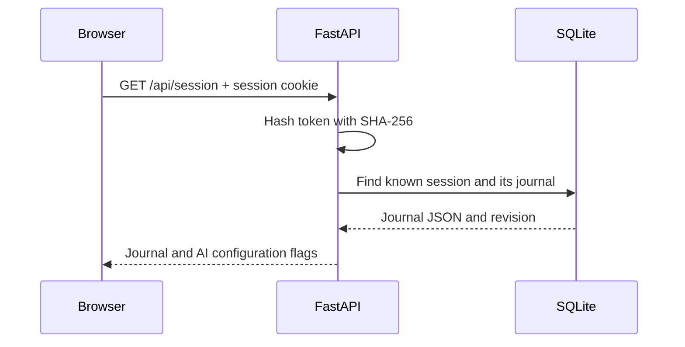

# How BurnRate remembers your journal without a login

Yes: restarting your phone normally keeps your journal. Reopen the same address in the same regular browser, with its site data intact. The server database must also still exist.

This guide explains cookie sessions. BurnRate now also has a recovery code and automatic database snapshots: see [recovery and backups](../data-protection/README.md).

## 1. Why a cookie is needed

HTTP requests do not automatically identify a returning browser. A cookie is a small value the server asks the browser to remember. The browser sends it back with matching requests. This lets the server connect separate requests to one session. See [MDN's cookie guide](https://developer.mozilla.org/en-US/docs/Web/HTTP/Guides/Cookies).

For BurnRate, think of the cookie as a claim ticket. The ticket identifies your journal; the journal itself is stored in SQLite on the server.

You do not need to type a username or password. However, the app still needs an identity, and the random ticket supplies an anonymous identity for this browser.

## 2. The first visit, step by step

1. The frontend calls `GET /api/health` to check that it reached the Python backend.
2. It calls `GET /api/session`.
3. The backend looks for a cookie named `burnrate_session`.
4. If the cookie is missing or unknown, Python creates a random token with `secrets.token_hex(32)`: 32 random bytes represented by 64 hexadecimal characters.
5. The backend stores the token's SHA-256 hash in SQLite and sends the original token to the browser using a `Set-Cookie` response header.
6. The frontend receives the journal and provider configuration flags. If this is a new session with no server journal, it uploads its current local journal.

An illustrative response header, with a placeholder token:

```http
Set-Cookie: burnrate_session=<random-token>; HttpOnly; Max-Age=31536000; Path=/; SameSite=strict
```

When `BURNRATE_SECURE_COOKIE=true`, the header also includes `Secure`.

The cookie token and the journal entry IDs serve different purposes. The server creates the session token with Python's `secrets` module. JavaScript creates UUIDs for individual entries, requests, and food drafts.

## 3. What happens when you return

The browser attaches its cookie automatically. The frontend uses `fetch` with `credentials: 'same-origin'` for its API calls.



The hash identifies a session row, which points to the journal's `user_id` through `journal_id`. Existing sessions use their original token hash as the journal ID; recovered sessions have a new token hash pointing to the same journal. The server uses the journal ID when reading and writing journal rows. Other API endpoints reject missing or unknown session cookies with HTTP 401.

Hashing the token keeps its directly usable value out of the session table. It does not encrypt the journal: the journal is JSON stored in SQLite.

## 4. Where each piece lives

| Piece | Location | Purpose |
| --- | --- | --- |
| `burnrate_session` cookie | Browser cookie storage | Identifies the anonymous server journal |
| Token hash | SQLite `sessions` table | Recognizes a known session |
| Journal JSON and revision | SQLite `journal` table | Stores confirmed journal state |
| Previous journal revisions | SQLite `journal_revision` table | Preserves saved snapshots |
| `burnrate-v1` | Browser `localStorage` | Local journal and browser backup |
| Gemini and DeepSeek keys | Server environment / `backend/.env` | Enables AI providers for all server sessions |

The database defaults to `backend/burnrate.db`; `BURNRATE_DB` can select another path.

The app saves changes locally, then queues server writes when connected. Local changes can exist before the server accepts them. A browser backup is useful, but it is on the same device and can be cleared alongside cookies.

On startup, an existing server journal takes priority over the local copy. BurnRate does not automatically merge conflicting journals or edits made across disconnected sessions.

## 5. Why LAN and VPN showed different data

Your two addresses have different hosts:

```text
LAN: http://192.168.1.10:4007
VPN: http://100.89.97.84:4007
```

BurnRate sets no cookie `Domain`, so the cookie belongs to the host that issued it. The browser keeps separate cookies for these two IP addresses. The server consequently sees two anonymous sessions, even though both addresses reach the same machine and database.

Cookies are not separated by port. By comparison, `localStorage` is separated by origin: scheme, host, and port. HTTP and HTTPS also have different local storage. See [MDN's localStorage reference](https://developer.mozilla.org/en-US/docs/Web/API/Window/localStorage).

Use one consistent hostname or IP that you can reach on both networks, in the same browser profile, to keep the same session. Switching networks alone does not create a new journal if you keep the same address and cookie.

AI keys are server configuration, independent of the journal's session. A different journal should still have the same AI features when it reaches the same backend. Origin restrictions, HTTP cookie settings, or frontend errors can prevent the connection.

## 6. Does the data survive a restart?

| Event | Expected behavior in this app |
| --- | --- |
| Refresh page, close browser, or restart phone | Same journal if cookie and browser storage remain |
| Restart PM2 or reboot server | Same journal if the SQLite database remains at the configured path |
| Switch Wi-Fi to VPN while keeping the same address | Same journal in the same browser |
| Open another browser, profile, or device | Separate session unless you transfer a backup |
| Open the LAN IP instead of the VPN IP | Separate session because the host changes |
| Clear cookies | New session; old server journal remains but the browser loses its identifier |
| Clear all site data | Cookie and local backup can both disappear |
| Close a private browsing session | Its temporary site data may be removed |
| Delete or replace the server database | Existing server journals are lost unless restored from a backup |

The current cookie has `Max-Age=31536000`, approximately one year from creation. It is a persistent cookie, even though its name contains "session". BurnRate currently does not refresh its expiry on every visit. Browsers or users can remove it sooner. Persistent cookie lifetime is described in [MDN's cookie guide](https://developer.mozilla.org/en-US/docs/Web/HTTP/Guides/Cookies).

The server currently has no matching session expiry or cleanup job. Cookie expiry therefore removes the browser's ticket, rather than automatically deleting the SQLite journal.

## 7. Losing the ticket versus losing the data

If you clear only the cookie, the original journal can still exist on the server. You can now use a previously saved recovery code in Settings to reconnect. Without a saved code or the original cookie, BurnRate still has no email or password recovery flow.

If local storage remains, the new session can upload that local copy as a new journal. This is a copy, not recovery of the original session. Do not rely on this if you are clearing all site data.

Use **Settings → Export JSON** for an independent journal backup. You can import it in another browser or address. Import replaces the current journal, and saves it to the current server session when connected; it does not link the two sessions or keep them synchronized.

For server migration, preserving SQLite preserves the journals. Copying `.env` preserves provider configuration, but `.env` does not contain journal data.

## 8. What the cookie attributes mean

| Attribute | Meaning |
| --- | --- |
| `HttpOnly` | Page JavaScript cannot read the cookie; the browser still sends it with requests |
| `SameSite=strict` | Restricts sending the cookie in requests originating from other sites |
| `Secure` | Requires HTTPS when enabled |
| `Path=/` | Applies across this host's paths |
| `Max-Age` | Sets the browser cookie's lifetime |

These are browser rules, documented in [MDN's cookie guide](https://developer.mozilla.org/en-US/docs/Web/HTTP/Guides/Cookies). They do not replace server checks. BurnRate also validates request origins and scopes database reads and writes to the session ID.

The token is a credential: someone who obtains it can act as that session. For an HTTPS deployment, enable the secure cookie. `HttpOnly` limits JavaScript access; it does not encrypt HTTP traffic or stop compromised page code from issuing requests.

## 9. How to apply this pattern elsewhere

Anonymous cookie sessions fit a guest shopping cart, temporary workspace, or small personal tool where users should start immediately. The reusable pieces are a random token, a cookie, server-side session lookup, and data scoped to that session.

If your next app needs dependable account recovery or automatic access across devices, add an account or pairing flow that links multiple sessions to one durable user ID. Cookies can still carry each browser's session token. BurnRate now has recovery-code pairing, but no account or email recovery flow.

To explore the implementation, read:

- `backend/app/main.py`: `/api/session`, cookie attributes, and the `user` dependency.
- `backend/app/storage.py`: `session`, `known_session`, `get`, and `save`.
- `frontend/dist/server.js`: session initialization and queued writes.
- `frontend/dist/app.js`: local storage, export, import, and startup hydration.

In browser developer tools, inspect Application/Storage → Cookies and Local Storage, then Network → `/api/session`. Inspect values privately: avoid sharing the real cookie token in screenshots or logs.
