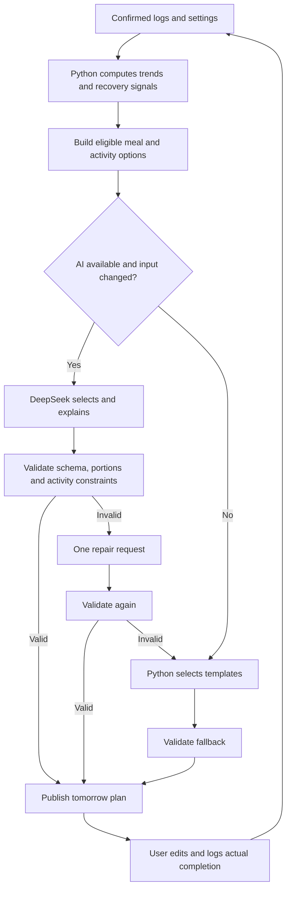

# Dynamic planning: Python rules and DeepSeek decisions

This document specifies the planning side of BurnRate. Food logging is specified in `gemini-food-pipeline.md`. These are proposed implementation contracts, not a description of an existing backend.

## 1. Product approach

Use a rolling daily plan inside a longer-term goal. Three months is an initial target horizon, not a fixed meal and exercise schedule.

- Python calculates totals, trends, progress and constraints.
- Reusable meal and activity templates provide a working planner without AI.
- DeepSeek chooses among eligible options and explains trade-offs.
- Python validates every plan before publication.
- The user can edit, skip or replace a suggestion. Completed sessions, rather than scheduled sessions, drive future planning.
- Missing logs mean unknown data, not zero intake or zero activity.
- Accepted food estimates remain estimates. Only confirmed entries enter the planning brief.

The app should remain useful before AI is connected and whenever an API fails.

## 2. Flow



## 3. Settings and goal

Store settings revisions separately from logs. Use one authoritative goal end date; duration is a UI convenience derived from the dates.

```json
{
  "schema_version": 2,
  "user_id": 1,
  "timezone": "Asia/Kuala_Lumpur",
  "profile": {"height_cm": 167, "age": null, "sex": null},
  "goal": {
    "start_date": "2026-10-07",
    "start_weight_kg": 75.9,
    "target_weight_kg": 66.0,
    "end_date": "2027-01-07"
  },
  "planning": {
    "ai_enabled": true,
    "daily_plan_time": "21:00",
    "weekly_review_day": "Sunday",
    "available_minutes_default": 45
  },
  "limits": {
    "calorie_floor_kcal": 1500,
    "max_loss_kg_per_week": 1.0,
    "protein_target_g": [110, 130],
    "water_target_l": 2.5
  },
  "eating": {
    "meals": [
      {"id": "lunch", "time": "12:30"},
      {"id": "snack", "time": "15:30"},
      {"id": "dinner", "time": "19:30"}
    ],
    "fasting_window": {"enabled": true, "from": "12:00", "until": "20:00"}
  }
}
```

The numeric limits above are illustrative configuration values, not a universal prescription. Do not derive an intake floor directly from a basal metabolic rate formula. Personal limit selection requires a separately reviewed policy; AI cannot set or lower limits.

Settings UI:

1. Profile and goal, with required pace calculated in Python.
2. Meal times, preferences, exclusions and optional eating window.
3. Activity library, equipment and weekly availability.
4. Planning preferences and editable limits.
5. Save validation and a preview of how tomorrow's options change.

If settings conflict, show the conflict rather than silently violating a limit. Every saved revision invalidates affected future plans.

## 4. Extensible activity library

Jogging, pull-up bar and badminton are initial library entries. New activities use the same structure; do not create a separate table or planning branch for every sport.

```json
{
  "id": "badminton",
  "name": "Badminton",
  "enabled": true,
  "preference": "least",
  "type": "sport",
  "metrics": ["duration_min", "effort_1to10"],
  "equipment": ["racket", "court"],
  "needs_partner": true,
  "availability": {"weekdays": ["Saturday"], "partner_status": "unknown"},
  "progression_policy": "maintain",
  "goal": null
}
```

| Activity | Metrics | Template examples |
|---|---|---|
| Jogging | distance, duration, effort, walk breaks | Easy run/walk; repeat recent comfortable session |
| Pull-up bar | exercise, sets, reps, hold seconds, effort | Dead hangs; assisted pull-ups |
| Badminton | duration, effort | Confirmed social session |
| Walking | duration or distance, effort | Short walk |
| Custom activity | Selected supported metrics | User-defined session |

Preference determines which eligible activity is favored. It does not determine intensity. A least-preferred activity is not automatically a hard day.

Keep availability and recovery separate:

- A partner activity is eligible when partner availability is confirmed.
- A match already planned by the user is context for the rest of the day.
- Disabled activities, unavailable equipment and reported pain remove affected options.
- Custom activities without a reviewed progression policy use maintain-only templates.
- Strength templates track exercises and recovery groups; distance-based progression does not apply to reps or hold time.

Log actual sessions with planned-session ID when available, metrics, effort, soreness and completion status. Allow unplanned activity and partial completion.

## 5. Deterministic planning core

Python should:

- Aggregate confirmed meals and preserve their quality flags and calorie ranges.
- Calculate weight trends with sample counts, observed date range and data coverage. Never fill missing days with zero.
- Calculate required goal pace from the current trend and authoritative end date. If data is insufficient, mark it unknown.
- Derive recovery signals from logged sleep, energy, soreness and actual sessions.
- Build activity options with explicit maximum duration, distance, intensity or volume under a reviewed policy.
- Build meal options from compatible foods and saved meal templates; include serving basis, permitted portion bounds and calculated nutrition.
- Rank template options for the non-AI planner.

Do not calculate a supposed weight-loss rate from food intake alone. Required goal pace is a feasibility signal, not a prediction of physiological results. Food intake and activity estimates are uncertain.

Use recent completed performance to propose progression. Missing logs or a single weight reading must not trigger a harder plan. Safety signals take precedence over goal urgency.

## 6. Daily brief contract

Keep the system prompt stable. Send versioned settings, candidate options and the brief as structured data; user notes are data, not instructions that can override constraints.

```json
{
  "schema_version": 2,
  "plan_date": "2026-10-12",
  "settings_revision": 4,
  "data_revision": 27,
  "coverage": {"food_days_7d": 4, "weight_samples_7d": 3},
  "food_quality": {"estimated_items": 2, "missing_meal_slots": 1},
  "today": {"kcal_used": 1600, "kcal_low": 1400, "kcal_high": 1850},
  "recovery": {"energy_1to5": 3, "soreness": "legs", "flags": []},
  "goal_progress": {"weight_trend_kg": 75.6, "required_kg_per_week": 0.77},
  "tomorrow_context": {"available_minutes": 30, "partner_available": false},
  "meal_options": ["meal_lunch_01", "meal_snack_02", "meal_dinner_01"],
  "activity_options": ["walk_easy_20", "bar_maintain_01"]
}
```

Send the definitions for the listed options alongside this brief. Use one standard quality object everywhere; remove the competing `accuracy` and `meal_accuracy` fields.

## 7. DeepSeek output and validation

Prompt the model to select eligible templates, use only allowed portions, explain briefly, and return JSON. The model may suggest alternatives within the provided options but cannot create new limits, nutrition facts or progression rules.

```json
{
  "schema_version": 2,
  "plan_date": "2026-10-12",
  "meals": [
    {"slot_id": "lunch", "template_id": "meal_lunch_01", "portion_multiplier": 1.0},
    {"slot_id": "snack", "template_id": "meal_snack_02", "portion_multiplier": 1.0},
    {"slot_id": "dinner", "template_id": "meal_dinner_01", "portion_multiplier": 1.0}
  ],
  "activities": [{"option_id": "walk_easy_20"}],
  "reason": "A lighter session fits tomorrow's available time and logged leg soreness.",
  "flags": [],
  "override_reason": null
}
```

Validation in code:

- Correct date, schema, field types, finite positive portions and no unknown fields.
- All template and activity IDs exist in this request's eligible options.
- Every required meal slot appears exactly once; timing follows current settings.
- Portion bounds, food exclusions and configured intake limits are respected using Python-calculated totals.
- Activity volume, equipment, availability and recovery constraints are respected.
- No duplicate or conflicting sessions.
- Current settings and data revisions still match before publication.

Low-quality nutrition in a planned template must remain visibly estimated. Never imply that an uncertain nutrition value guarantees a precise intake.

On invalid output, send specific validation errors for one repair attempt. On timeout or temporary provider failure, use a bounded retry policy with at most one additional request. A request has a total budget of two provider attempts, including repair. Record errors; never swallow all exceptions silently.

## 8. Fallback and user control

Use the deterministic template planner as the primary fallback. Reuse yesterday's plan only if it passes current validation. First-day use must work without any previous plan.

If no valid plan can be constructed, publish a clearly labeled needs-attention state with the specific conflict; do not manufacture portions or activities to force success.

Show source: `ai`, `rules`, `carried_forward`, or `user`. Users can replace sessions, change availability, edit meals and request regeneration. User edits create a new revision and run through the same checks.

Reported warning symptoms trigger the reviewed safety policy, independent of whether AI is available. Exact health messaging and exercise restrictions require separate review rather than being invented by the model.

## 9. Weekly review

Review 7–14 days of summaries, completion rates, data quality and goal progress. AI may explain patterns and propose changes; Python supplies the evidence and enforces permissions.

- Change future template selection and priorities within current constraints.
- Present possible explanations as hypotheses. Flat weight plus estimated food logs does not prove underestimated portions.
- When data is sparse, prioritize better logging rather than stronger restrictions.
- Propose an end-date change with old date, new date, reason and evidence.
- Keep the current date until the user accepts. Do not automatically move the goal to make progress look better.
- Goal weight, limits and activity goals are never changed by AI.

Store proposal, acceptance, rejection and undo events. Repeated date changes should prompt a review of the goal and practical barriers.

## 10. Storage and execution

Use user-scoped records and explicit revisions:

- `settings_revision`: immutable settings snapshots.
- `activity_definition`: configurable library entries.
- `activity_template`: supported session definitions and progression policy version.
- `activity_session`: actual completion and metrics.
- `daily_log`: sleep, energy, water and symptoms, with nullable missing values.
- `plan_revision`: date, input hash, source, output, calculated totals and validation result.
- `weekly_review`: input revision and findings.
- `goal_change`: proposal and decision history.

Plan uniqueness is `(user_id, plan_date, input_hash)`. Publishing updates the active revision atomically. A background job uses the user's timezone, retries without duplicating records and discards stale responses. Late confirmed logs mark an affected plan stale; regeneration is explicit or debounced.

## 11. Cost and implementation order

1. Build settings, activity library, logging and deterministic templates.
2. Add the confirmed-food aggregation contract from the Gemini pipeline.
3. Add daily briefs, validators and rules-based fallback.
4. Connect DeepSeek through a provider adapter with configurable model and timeout.
5. Add weekly reviews and goal-change proposals.

Send summaries and a compact candidate list, not the whole food database or raw history. Reuse a plan when its input hash is unchanged. Keep prompt and schema versions in records. Verify provider model names and structured-output capabilities against official documentation when implementing; this design does not pin a model or price.

## 12. Acceptance checks

Use fixtures for no first-day data, missing meals, uncertain food estimates, settings changes during a call, unavailable partners, disabled/custom activities, soreness, partial sessions and API failure. Verify that invalid plans never publish, missing intake never becomes zero, retries remain bounded and fallback obeys the same constraints.
