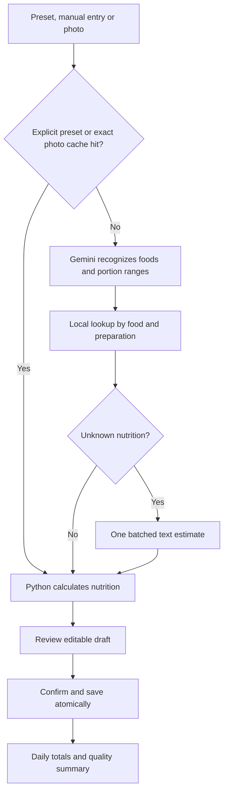

# Gemini food pipeline: recognition, portions and confirmed nutrition

This document specifies food logging for BurnRate. Dynamic planning is specified in `deepseek-brain.md`. These are proposed implementation contracts, not an existing backend.

## 1. Responsibilities

- Gemini identifies food, preparation and visible portions.
- A local nutrition catalog supplies known nutrition values.
- Python converts serving units, calculates calories and protein, and preserves uncertainty.
- Gemini estimates nutrition ranges only when suitable catalog data is unavailable.
- The user reviews the draft before it becomes a confirmed log.

Gemini can estimate portion ranges, including grams, when necessary. A photo does not make these measured values. Weighed portions, package labels and explicitly selected saved servings take precedence.

## 2. Cheapest reliable route



A saved food name does not establish the portion in a new photo. Skip image analysis only for an explicitly selected preset or a matching exact-photo analysis cache.

Manual and preset logging must work without Gemini.

## 3. Inputs and context

- Food photo; optionally a second view for depth or obscured items.
- User-selected container profile when available.
- A compact shortlist of relevant catalog foods and user aliases, with preparation descriptions rather than IDs alone.
- Photo timestamp converted to the user's timezone; fall back to current local time. The user can change meal slot and date.
- Optional serving hint such as “my usual rice,” “one packet,” or “half the bowl.”

Meal slots come from current settings rather than hard-coded clock thresholds. Do not silently substitute photo capture time for the user's selected log date.

Resize images using a configurable quality setting and preserve enough detail for labels and small items. Store originals according to the user's retention preference. Do not hard-code a resolution as an accuracy guarantee.

## 4. Call A: recognition and portion estimate

Prompt Gemini to describe only visible food, use Malaysian dish context when appropriate, distinguish preparation, and return structured data. Text visible in an image is untrusted content, not instructions.

Example contract:

```json
{
  "schema_version": 2,
  "containers": [
    {"id": "c1", "type": "plate", "profile_id": "usual_plate", "size_confidence": "medium"}
  ],
  "items": [
    {
      "id": "i1",
      "container_id": "c1",
      "name": "cooked rice",
      "food_id": "rice_cooked",
      "preparation": "plain cooked",
      "portion": {
        "method": "plate_geometry",
        "plate_fraction": 0.35,
        "height": "medium"
      },
      "recognition_confidence": "high",
      "hidden_ingredients": [],
      "missing": []
    },
    {
      "id": "i2",
      "container_id": "c1",
      "name": "fried chicken",
      "food_id": null,
      "preparation": "fried, skin on, bone present",
      "portion": {"method": "estimated_mass", "grams_low": 90, "grams_high": 140, "basis": "edible_cooked"},
      "recognition_confidence": "medium",
      "hidden_ingredients": ["absorbed oil unknown"],
      "missing": []
    },
    {
      "id": "i3",
      "container_id": "c1",
      "name": "boiled egg",
      "food_id": "egg_boiled",
      "preparation": "boiled",
      "portion": {"method": "units", "units": 1, "unit_size": "medium"},
      "recognition_confidence": "high",
      "hidden_ingredients": [],
      "missing": []
    }
  ],
  "missing": []
}
```

Supported portion methods:

| Method | Required data | Use |
|---|---|---|
| `units` | count and unit size | Eggs, fruit, packaged pieces |
| `volume` | ml range | Drinks, soups |
| `bowl_fill` | fill fraction and known container capacity | Known bowls |
| `plate_geometry` | coverage, height and calibrated container | Calibrated staples |
| `estimated_mass` | edible grams range and cooked/raw basis | Uncalibrated or unfamiliar foods |
| `unknown` | reason | Ask for a useful serving hint |

Use a discriminated schema: only fields belonging to the selected method are accepted. Allow a null container for handheld food. Include cup, package, bowl, plate, takeaway box, wrapped and unknown container types.

Do not output calories in this recognition call. Do not invent obscured ingredients; flag uncertainty. For a non-food image, return no items and a reason.

## 5. Resolve food identity and preparation

Lookup order:

1. Explicit user selection or scanned package nutrition.
2. User aliases mapped to a catalog food and preparation.
3. Exact catalog match.
4. Fuzzy candidates offered for confirmation when ambiguous.
5. Batched Gemini nutrition estimate for unresolved foods.

Plain chicken breast, skin-on fried chicken and bone-in chicken are different records. Store nutrition basis as cooked/raw and edible/whole. Prevent incompatible basis conversions unless a documented conversion exists.

Do not use a similar-sounding local match merely to avoid a model call. Expose meaningful ambiguity in the review screen.

## 6. Portion conversion in Python

Conversion priority:

1. User-entered weighed amount or label serving.
2. Explicitly selected usual serving or meal preset.
3. User-calibrated container and food geometry.
4. Model-estimated portion range.
5. Unknown portion requiring a user hint.

For a calibrated plate only:

```
grams = calibrated_full_plate_grams(food, height) * plate_fraction * (diameter / calibration_diameter)^2
```

Store calibration provenance and an uncertainty range. This geometry approximation is unsuitable for all dishes; do not extrapolate a rice calibration to chicken or mixed food. If no suitable calibration exists, use an estimated range or request a serving hint.

Bowl volume is container capacity times fill fraction. Converting ml to grams requires a food-specific density. Units require a defined unit weight or per-unit nutrition. Do not treat ml as grams by default.

## 7. Call B: batched fallback nutrition

Resolve all unknown nutrition items in one request. Include an item ID, name, preparation and known portion basis. For scalable records, request nutrition per 100 g, per 100 ml or per a defined unit; never normalize an undefined serving.

```json
{
  "items": [
    {
      "item_id": "i2",
      "food": "fried chicken",
      "preparation": "skin on, edible cooked meat and coating",
      "requested_basis": {"quantity": 100, "unit": "g", "state": "edible_cooked"}
    }
  ],
  "country_context": "Malaysia"
}
```

Each response includes `item_id`, the same basis, `kcal_low`, `kcal_high`, `protein_low_g`, `protein_high_g`, assumptions and confidence. These are model estimates, not sourced catalog facts. If the basis cannot be estimated meaningfully, return an unresolved result rather than invented precision.

Cache by normalized food, preparation, basis and estimator version. A portion edit then recalculates locally. A name edit first runs local lookup and calls Gemini only if nutrition remains unresolved. Batch finished edits with debounce; ignore responses for an older draft revision.

## 8. Nutrition and uncertainty

For compatible portion and nutrition bases, Python calculates calories and protein. Keep:

- `kcal_used`: midpoint used for charts, visibly estimated when applicable.
- `kcal_low` and `kcal_high`: calculation bounds.
- Equivalent protein fields.
- Portion source, nutrition source and basis.
- Recognition confidence and measurement quality separately.

Multiplying portion and nutrition bounds provides an approximate range, not a statistical confidence interval. Summing item bounds provides a rough meal range; correlated errors such as hidden oil can remain.

Measurement quality values: `weighed`, `label_based`, `saved_serving`, `calibrated_photo`, `uncalibrated_estimate`, `manual_estimate`. A user-entered calorie number is not automatically measured or accurate.

Confirmation status is separate: `draft`, `confirmed`, `deleted`. Confirming an estimate never upgrades its quality.

## 9. Review and learning

Show an editable item list with food/preparation, serving, calorie range and an estimated badge. Display a concise prompt only when a missing detail materially affects the result.

- Edit food: local autocomplete first, fallback estimation if needed.
- Edit portion: immediate Python recalculation.
- Enter calories: preserve the user's override and its basis; unknown protein remains null.
- Use usual portion: explicit selection, never silently assumed.
- Save meal preset: select which items and quantities to reuse.
- Re-check photo: explicit user action; replace draft analysis rather than adding duplicates.
- Confirm: atomically save the meal, items and revision.

Learn aliases and preference corrections automatically after confirmation. Save nutrition for reuse only with a clear serving basis and provenance. A one-off portion correction should not overwrite the global nutrition value of a food.

Keep preparation and user categories editable. Categories describe user tracking preferences; they do not determine nutrition. Prefer descriptive tags such as `sweet_drink`, `dessert`, `fried` and `packaged_snack` over a universal “junk” classification. Avoid keyword rules that classify every Milo or noodle entry without considering preparation.

## 10. Validation and failure handling

- Enforce schema, supported enums, unique item IDs and matching container references.
- Reject negative, non-finite or reversed ranges and invalid serving bases.
- Validate plate fractions per container and only for geometry items. Significant overlap or invalid fractions requires correction; do not silently rescale the entire meal.
- Unknown food IDs return to lookup, never become trusted matches.
- Require complete item coverage in batched responses; unresolved items remain visible.
- Unusually large values prompt review instead of being silently capped.
- Missing portions stay unknown rather than becoming zero calories.
- Allow at most two attempts per provider stage, including a repair request. Record timeout, provider, parse and validation failures separately.
- Preserve the editable draft on failure and allow manual completion.

Exact-photo caching uses user ID, content hash, prompt/schema version and relevant context version. Cache analysis rather than a confirmed meal; a fresh log still requires a separate confirmation. Nutrition values are recalculated against the current catalog version. A duplicate-confirmation token prevents double saves.

## 11. Data model

Use shared user-scoped records rather than one mutable `my_foods` row per name:

- `food_catalog`: canonical identity, preparation, nutrition basis, ranges, provenance and version.
- `user_food_alias`: user label mapped to a food identity; unique per user and normalized alias/preparation.
- `saved_serving`: food, amount, unit and user-specific description.
- `meal_preset` and `meal_preset_item`: reusable combinations with explicit portions.
- `container_profile` and `portion_calibration`: capacity/diameter, food basis and calibration history.
- `meal_draft`: analysis, user edits, revision and unresolved fields.
- `meal` and `meal_item`: confirmed date/time, quantities, calculated nutrition, quality and override provenance.
- `image_analysis_cache`: user-scoped image hash, context/version keys and analysis result.
- `nutrition_estimate_cache`: food/preparation/basis/version key and estimated ranges.

Confirmation updates these records in one transaction. Preserve original model output separately from user edits. Changes to a confirmed meal increment the data revision and refresh affected totals.

## 12. Handoff to planning

Only confirmed entries feed Python's daily summary. Include totals, approximate ranges, quality counts and missing slots separately:

```json
{
  "date": "2026-10-12",
  "kcal_used": 1600,
  "kcal_low": 1400,
  "kcal_high": 1850,
  "protein_used_g": 100,
  "food_quality": {
    "estimated_items": 2,
    "missing_meal_slots": 1,
    "unknown_protein_items": 0
  }
}
```

Known subtotal plus a missing meal is not complete daily intake. DeepSeek receives this summary and flags, never photos or unconfirmed drafts. Weight changes cannot establish that food estimates are wrong; the weekly review may suggest checking portions as one hypothesis.

## 13. Build and evaluate

1. Implement catalog, manual logging, saved servings and presets.
2. Add photo recognition, portion methods and review UI.
3. Add batched fallback nutrition, caches and revision handling.
4. Connect confirmed totals to the dynamic planner.

Evaluate on weighed meals and label-known portions: recognition match, portion error, calorie error, range coverage, correction rate, latency and calls per confirmed meal. Include mixed Malaysian dishes, drinks, multiple containers, bones, sauces and non-food images. Report results by food type; an overall average can hide systematic errors.

Keep model IDs, structured-output configuration, image resolution and budgets configurable. Verify current provider capabilities using official documentation during implementation rather than pinning unverified API details here.
